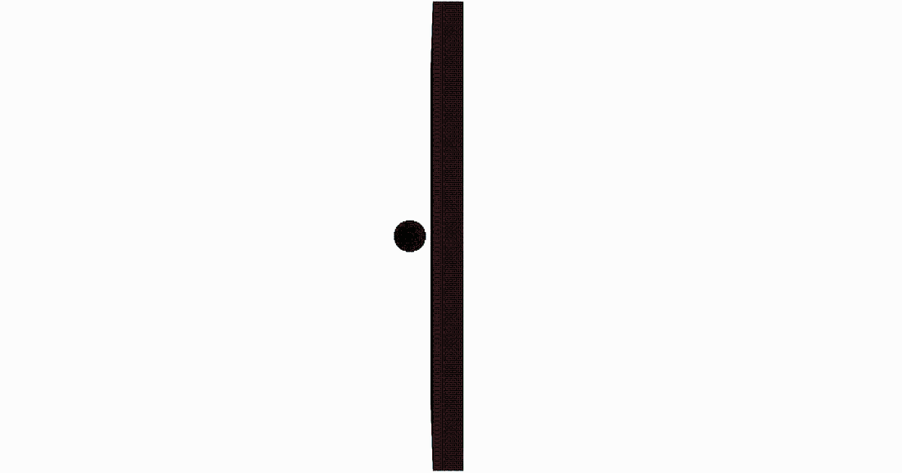

# Riccardo Savio · Aerospace Engineering Portfolio

MSc Aerospace Engineering (Aerogasdynamics) at **Politecnico di Torino**, graduating in **March 2027**.
I work on **hypersonic aerothermodynamics** and **high-speed impact**: my thesis, carried out at the
**Université libre de Bruxelles** and the **von Karman Institute for Fluid Dynamics**, follows a piece of space debris
from the moment it hits a spacecraft shield to the moment the damaged heat shield faces a supersonic, high-enthalpy flow.

[LinkedIn](https://www.linkedin.com/in/riccardo-savio/) · [Email](mailto:riccardosavio02@gmail.com) · Brussels, Belgium · available from April 2027

---

## Current work: MSc thesis (ULB + VKI)

*Thermomechanical behaviour and crack propagation of reusable Thermal Protection Systems subjected to high-velocity
ballistic impact*, within the HITS project. Supervisors: Prof. T. Magin (ULB/VKI), Prof. D. D'Ambrosio (Politecnico di Torino).

  

| Phase | Where | What | Status |
|---|---|---|---|
| **1. Hypervelocity impact** | ULB, Brussels | Abaqus/Explicit model of a 7 km/s impact on a ceramic/aluminium Whipple shield, with adaptive FEM→SPH conversion and **my own user material in Fortran (VUMAT)** for all three bodies | Completed |
| **2. Aerothermodynamics** | VKI, Rhode-Saint-Genèse | **Coupled flow–thermal simulations** of the VKI **Plasmatron** in its supersonic flat-plate configuration: **shock waves**, supersonic boundary layer, wall heat flux on damaged samples | In progress |

**Phase 1 in numbers**, against the LS-DYNA model of Moore and Teixeira-Dias (2025) and the tests and simulations of Ren et al. (2021):
perforation within 5.5 %, ejecta angle within 10 %, axial pressure within 8 %, energy balance within 0.1 %, mesh-converged.

→ The VUMAT, the Python generator of the Abaqus model and the results: **[Thesis/](./Thesis)**

---

## Repository structure

| Folder | Content |
|---|---|
| **[Thesis](./Thesis)** | MSc thesis: user material (Fortran VUMAT, Apache 2.0) with the model set-up and results; VKI phase in progress |
| **[Projects](./Projects)** | Reports: BSc thesis, hypersonics, CFD, aeroacoustics, aircraft design |
| **[Publications](./Publications)** | Conference papers (ESA PAC Symposium 2026, DARLI-AP 2026) |
| **[Certifications](./Certifications)** | STK Level 1, Swagelok, Cambridge C1 Advanced, EASA drone pilot A1/A3 |

---

## Beyond the thesis

* **PoliTo Rocket Team** (Nov 2023 – Oct 2026). Propulsion engineer on the feed system of *Efesto*, the team's first
  bi-liquid rocket engine; lead of the test bench division; then **Project Manager of VES Mk3**, about 100 students
  through PDR, CDR and TRR to a launch and recovery in October 2026. [Team website](https://www.politorocketteam.it/about/current-team)
* **Alta Scuola Politecnica** (2025 – 2026), the joint honours programme of Politecnico di Torino and Politecnico di Milano:
  team leader of **SkiSlo**, a digital twin of ski slopes for athlete safety. [Project website](https://skislo.eu/home/en/)

## Skills

**CFD** ANSYS Fluent, STAR-CCM+, high-order DG solver · **FEA** Abaqus/Explicit, Fortran user subroutines, FEM–SPH ·
**Pre/post** Gmsh, ParaView, Tecplot · **Programming** Python, Fortran, C++ (basic), Linux/HPC, LaTeX ·
**CAD & mission analysis** SolidWorks, STK · **Languages** Italian (native), English (C1)

## Licence

The Abaqus user material and the thesis results in [`Thesis/ULB_Hypervelocity_Impact`](./Thesis/ULB_Hypervelocity_Impact) are © 2026 Riccardo Savio:
code under [Apache 2.0](./Thesis/ULB_Hypervelocity_Impact/LICENSE), text and figures under CC BY 4.0. Reuse requires credit to the author;
to cite, use GitHub's *Cite this repository* ([CITATION.cff](./CITATION.cff)).
