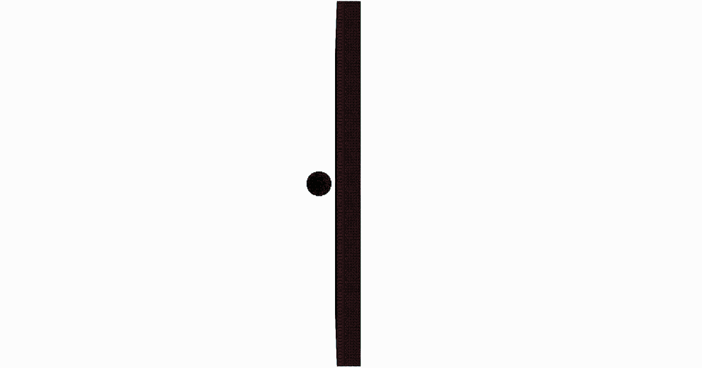
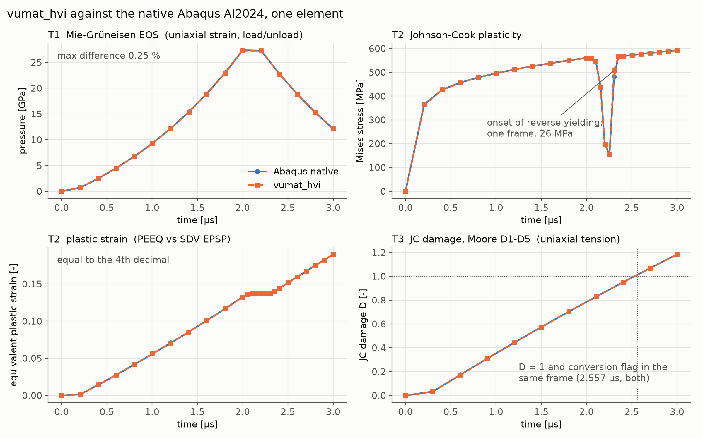
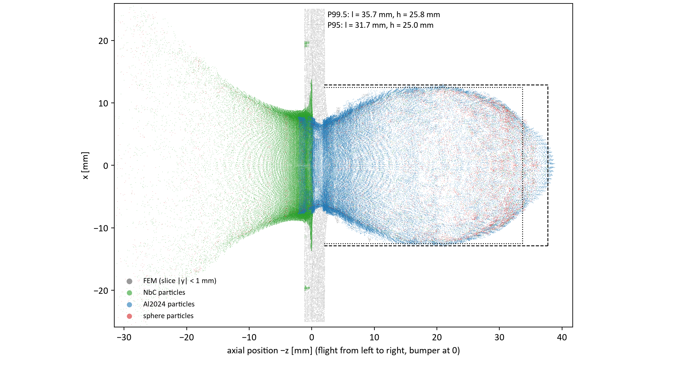
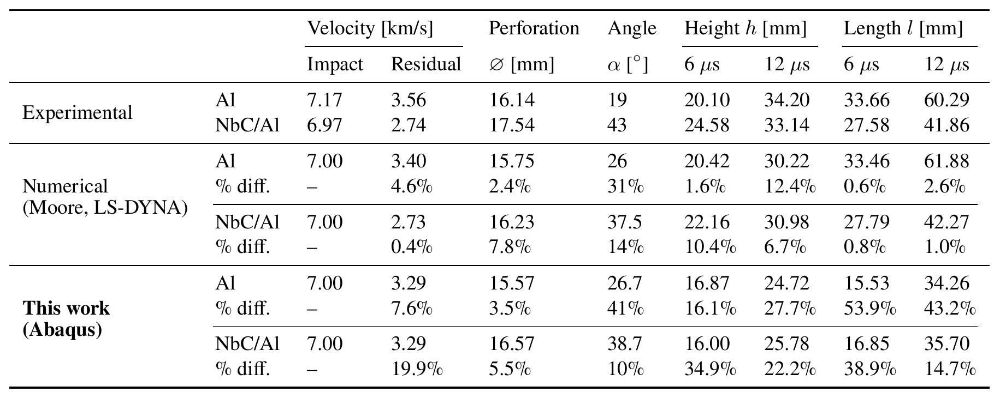
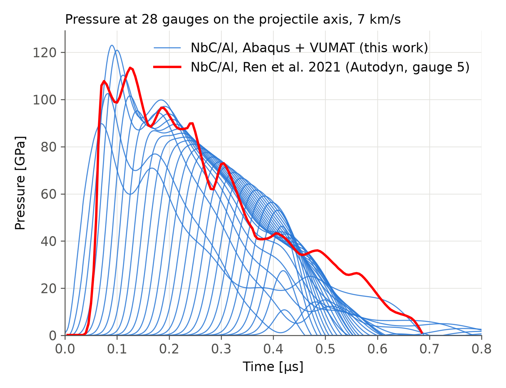

# Hypervelocity impact on a Whipple shield · Abaqus/Explicit + VUMAT

Phase 1 of my MSc thesis, carried out at the Université libre de Bruxelles.
**Can Abaqus/Explicit reproduce a 7 km/s impact on a ceramic/aluminium shield?** The reference case is "Target 2" of
Moore and Teixeira-Dias (2025): an Al2024 sphere at 7 km/s on a bumper of niobium carbide (NbC) bonded to an Al2024 plate,
simulated in LS-DYNA and tested by Ren et al. (2021).

<p align="center"></p>

## Files

| File | Content |
|---|---|
| [`vumat_hvi.f`](./vumat_hvi.f) | User material, Fortran 77 (~900 lines). Needs Abaqus's own `vaba_param.inc` (licensed by Dassault, not included) |
| [`generate_inp.py`](./generate_inp.py) | Python generator of the Abaqus input deck: mesh of the three bodies, sets, the single section, materials, contact, step and outputs (Python 3, PyYAML) |
| [`config_impact.yaml`](./config_impact.yaml) | Input of the generator for the run shown below: geometry, mesh, material constants and solver settings |
| [`LICENSE`](./LICENSE), [`NOTICE`](./NOTICE) | Apache 2.0 licence and attribution notice (see [Licence](#licence)) |
| [`figures/`](./figures) | Animation, debris cloud at 12 µs, comparison table, pressure gauges, verification of the VUMAT |

## Model

| | |
|---|---|
| **Projectile** | Al2024 sphere, Ø 4 mm, 7 km/s normal to the plate, 0.8 mm stand-off; Cartesian hexahedral mesh, 29 elements across the diameter |
| **Bumper** | NbC 50 × 50 × 1.17 mm (340 × 340 × 7 C3D8R) tied to Al2024 50 × 50 × 2 mm (340 × 340 × 14 C3D8R); edges clamped. 2.4 M elements in total |
| **Section** | **One** solid section and **one** user material for all three bodies: in Abaqus, SPH particles of different sections do not interact, so with native materials the converted ceramic never touches the aluminium |
| **FEM → SPH** | `*Section Controls, element conversion=YES, conversion criterion=USER, sph conversion=PER ELEMENT`, one particle per element, distortion control (length ratio 0.7). The VUMAT sets SDV 4 to 0 to convert an element |
| **Contact** | General contact on exterior **and interior** faces (eroding contact), friction 0.2, penalty stiffness × 10, nodal erosion; no NbC/Al contact pair (the plates are tied and the particles share one kernel) |
| **Step** | `*Dynamic, Explicit`, 12 µs, `nlgeom`, bulk viscosity 0.6 / 1.2, variable mass scaling only on the elements whose stable increment falls below 1e-10 s. Adiabatic heating not modelled |
| **Units** | mm, tonne, s, MPa |

### Materials (props of `*User Material, constants=56`)

| Props | Al2024 (plate and sphere) | Value |
|---|---|---|
| 1–5 | G, ρ₀, c₀, s, Γ₀ (Mie–Grüneisen, linear Us–Up) | 27.6 GPa, 2800 kg/m³, 5328 m/s, 1.338, 2.0 |
| 6–10 | Johnson–Cook A, B, n, C, ε̇₀ | 265 MPa, 426 MPa, 0.34, 0.015, 1 s⁻¹ |
| 11–15 | Johnson–Cook damage D1–D5 | 0.112, 0.123, 1.5, 0.007, 0 |
| 16 | σ_max: conversion on the largest principal stress | 2600 MPa |
| 24 | ε_c: conversion on the equivalent plastic strain | 0.35 |

| Props | NbC, Johnson–Holmquist 2 (same order as Abaqus `ABQ_JH2`) | Value |
|---|---|---|
| 25–32 | ρ₀, G, A, N, B, M, C, ε̇₀ | 4800 kg/m³, 164 GPa, 0.88, 0.64, 0.28, 0.6, 0.007, 1 s⁻¹ |
| 33–38 | T, σᵢ,max\*, σf,max\*, HEL, p_HEL, β | 262 MPa, 1.2, 0.15, 6570 MPa, 3440 MPa, 1.0 |
| 41–46 | D1, D2, εf,max, εf,min, FS, lDamage | 0.001, 0.5, 1.2, 0, 0.1, 0 |
| 49–51 | K1, K2, K3 | 238, 160, 277.4 GPa |

Book-keeping props: 17 = number of solid elements, 18 = particles per element (1), 19 = first particle label,
20–21 = first and last NbC element label, 22 = energy transfer to particles (0 = off), 23 = first sphere element label.
NbC is selected by element label, so one `*Density, dependencies=1` gives each body its density through a field variable
(0 = Al2024, 1 = NbC).

**State variables** (`*Depvar 9, convert=4`): EPSP, damage D, volumetric strain, CONV (1 = FEM, 0 = convert), σ₁,
pressure, bulking pressure (NbC), plastic strain rate (NbC), body (1 sphere, 2 NbC, 3 Al2024). Initialise CONV to 1.

### Run

```bash
python3 generate_inp.py config_impact.yaml        # writes impact.inp (2.4 M elements, ~290 MB)
abaqus job=impact input=impact.inp user=vumat_hvi.f double=both cpus=1
```
Change the mesh with `geometry.nbc/al.nx, ny, nz` and `geometry.sphere.n_div` in the YAML, or on the command line
(`--set geometry.sphere.n_div=36`); any other entry can be overridden the same way.
Use one CPU without `domains=`: Abaqus 2025 (no Feature Pack) crashes in the SPH packager with more than one domain.

## Verification of the user material

Every branch was checked against the native Abaqus material on single-element tests: Mie–Grüneisen pressure within 0.25 %,
Johnson–Cook plastic strain equal to the 4th decimal, damage and conversion flag reaching D = 1 in the same frame;
JH-2 identical to `ABQ_JH2` in tension, same fractured strength in compression. The routine also runs clean in block drivers
with NaN-poisoned outputs and floating-point traps, in single and double precision.

<p align="center"></p>

## Results at 12 µs

<p align="center"></p>

<p align="center"></p>

* **In agreement:** perforation diameter within 5.5 % of the experiment, ejecta angle within 10 %, axial pressure history
  within 8 % of Ren's gauges, energy balance within 0.1 %, mesh-converged (a 1.2× finer mesh changes the results by < 1 %).
* **Open:** the debris cloud is 15–22 % shorter than measured and its head is about 20 % faster. Seventeen numerical
  variants, eight sets of ceramic constants, the plate boundary conditions and the mesh do not move it; only the conversion
  criterion does.

<p align="center"></p>

## References

* Moore and Teixeira-Dias (2025), FEM–SPH simulation of hypervelocity impact on ceramic/aluminium shields in LS-DYNA (constants of both materials).
* Ren et al. (2021), hypervelocity impact tests and Autodyn simulations of NbC/Al2024 shields.
* He et al. (2020), Al2024 constants and the principal-stress conversion criterion.

## Licence

© 2026 Riccardo Savio. The code (`vumat_hvi.f`, `generate_inp.py`, `config_impact.yaml`) is released under the [Apache License 2.0](./LICENSE): you may use and modify it,
but every copy or derivative must keep the copyright notice and the [NOTICE](./NOTICE) file, and modified files must say
that they were changed. Text, tables and figures in this folder are released under
[CC BY 4.0](https://creativecommons.org/licenses/by/4.0/): any reuse must credit the author.
If you use this work in a publication, please cite it ([CITATION.cff](../../CITATION.cff)).
